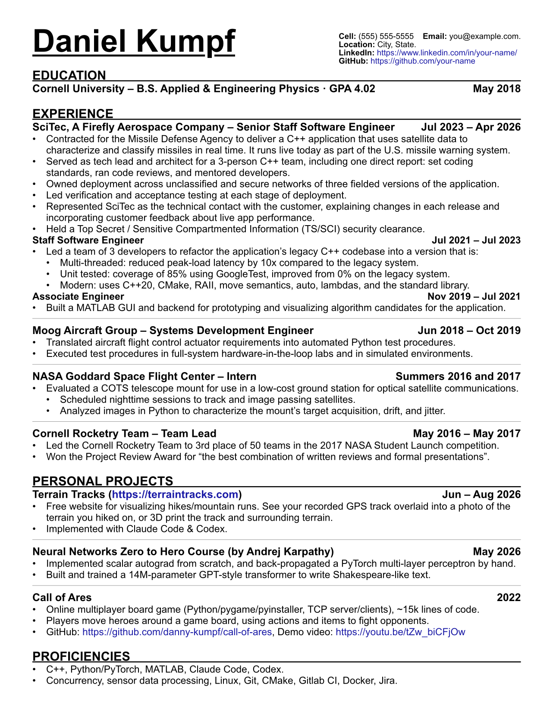

# Resume generator

[Resume content by Me; all else by Claude Opus 5.5]

Write the content in `resume.yaml`. `resume.typ` (a [Typst](https://typst.app) template) lays it out into a one-page PDF.



## Usage

You need [Typst](https://typst.app) and [uv](https://docs.astral.sh/uv/) on your PATH. `uv` installs the Python dependencies itself the first time you run anything with `uv run`, so there's no separate install step.

The contact block (phone, email, links) lives in `contact.yaml`, which is gitignored so it never gets committed. On a fresh clone, create it from the example first:

```
cp contact.example.yaml contact.yaml    # then fill in your details
```

```
uv run build.py            # build once
uv run build.py --watch    # rebuild on every save
```

Each build writes two files:
- `Kumpf_Resume.pdf`: the real resume, with your contact details from `contact.yaml`. It's gitignored.
- `docs/resume_preview.png`: the image at the top of this README. It uses the placeholder details from `contact.example.yaml`, so commit it whenever it changes.

For a live side-by-side preview in VS Code, install the **Tinymist Typst** extension, open `resume.typ`, and click "Preview". The preview updates when you edit `resume.yaml`.

### Tailored variants

Copy `resume.yaml` to a new file (for example `resume_cpp.yaml`) and build from that copy:

```
typst compile resume.typ Kumpf_Resume_Cpp.pdf --input data=resume_cpp.yaml
```

## Tests

Applicant tracking systems read the PDF's text, not the page image. `tests/test_text_extraction.py` builds every `resume*.yaml` and reads each PDF with pypdf, pdfminer.six, PyMuPDF, and poppler's `pdftotext`. Each extractor must return all of the YAML's text unbroken and in reading order. The `pdftotext` check is skipped if it's not on PATH.

```
uv run pytest tests
```

The test dependencies are listed in `pyproject.toml` and pinned in `uv.lock`. Commit `uv.lock` so everyone gets the same versions.

## Editing content

The comments at the top of `resume.yaml` explain the format: `**bold**`, `[label](url)`, bare URLs that become links automatically, and nested bullets.

## Vertical spacing

The template measures the content and splits the leftover page height across the gaps between sections and between entries. A section gap gets twice the share of an entry gap. When you remove a line, every gap grows a little. Growth is capped, so a much shorter resume leaves the extra space at the bottom instead of spreading out too far. If the content is too long, it spills onto page 2.

You can tune this with the `spacing` and `style` blocks at the top of `resume.typ`: fonts, sizes, margins, indents, and minimum gap sizes.
